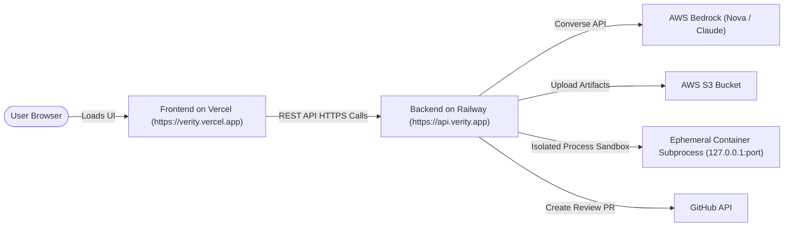

# Verity: End-to-End Pipeline, AWS Architecture, Pricing & Cloud Deployment Guide

This document provides a comprehensive operational breakdown of Verity: how the 5-stage automated pipeline works, which AWS services are leveraged, the exact cost structure and business pricing model, what executes locally versus in the cloud, and a step-by-step deployment guide for running the backend on **Railway** and the frontend on **Vercel**.

---

## 1. How the End-to-End Pipeline Works

Verity is designed around the core tenet: **"No proof, no alert. No failed exploit, no merge."** Instead of acting as a static code linter that drowns developers in theoretical warnings, Verity acts as an autonomous security engineer.

```mermaid
flowchart TD
    A["1. Code Input (Local target/ or GitHub clone)"] --> B["2. Static Hypothesis Scanner (Regex & AST)"]
    B --> C["3. Live Exploit Sandbox (Spins up Flask on 127.0.0.1:port)"]
    C -->|Simulate Attack: Alice steals Bob's note| D{Exploit Succeeded?}
    D -->|No (Safe)| E["Discarded as False Alarm (0 Developer Fatigue)"]
    D -->|Yes (Confirmed)| F["4. Defensive Code Patcher (AWS Bedrock)"]
    F --> G["5. Replay Sandbox (Spins up Patched App on new port)"]
    G -->|Replay Attack: Alice tries again| H{Is Attack Blocked? HTTP 403}
    H -->|No| F
    H -->|Yes (Verified Blocked)| I["6. Pytest Regression Test Generation"]
    I --> J["7. Store Artifacts to AWS S3 & Prepare 1-Click Delivery"]
    J --> K["UI: Download app.py / 1-Click Codebase Apply / GitHub PR"]
```

### Stage-by-Stage Breakdown

| Stage | Process | What Actually Happens |
| :--- | :--- | :--- |
| **1. Scan** | `scanner.py` | Scans route signatures for common vibe-coding patterns: missing `current_user()` checks on database IDs, unparameterized SQL queries, and exposed admin endpoints. Emits structured hypotheses (`route`, `vuln_type`, `line`). |
| **2. Verify** | `sandbox.py` + `attacks.py` | Allocates an unused random port on localhost, boots the application in an isolated subprocess with a seeded SQLite database (`users`, `notes`), and executes a realistic exploit (e.g. User Alice sending `X-Token: alice-token` to `/notes/2` belonging to Bob). If Bob's secret is returned (`HTTP 200`), the bug is confirmed real. If not, it is discarded. |
| **3. Patch** | `patcher.py` + `bedrock_client.py` | Sends the vulnerable code and exploit context to **AWS Bedrock** with strict prompt constraints. Bedrock outputs defensive code adding ownership verification (`if note['user_id'] != user['id']: return 403`) and generates a non-technical, plain-English explanation for vibe coders. |
| **4. Replay** | `sandbox.py` + `attacks.py` | Verity creates a new sandbox folder (`runs/<id>/patched/`), boots the *patched* app on another ephemeral port, and fires the exact same exploit again. It verifies that Alice is now blocked with `HTTP 403 Forbidden`. |
| **5. Regression Test** | `tests/test_security_<id>.py` | Verity generates a permanent `pytest` test script that boots the patched sandbox and asserts that the exploit cannot succeed. It runs `pytest` via subprocess to ensure test suite compliance. |
| **6. Publish & Deliver** | `storage.py` + `api.py` | Uploads the state, patch diff, and regression test to **Amazon S3**. Updates the API state so the frontend displays the verified findings, the before/after visual proof, a direct **"Download Fixed app.py"** button, and a **"1-Click Apply to Codebase"** button. |

---

## 2. AWS Tools Involved: What They Are & What They Do

Verity relies on two AWS services configured via `.env`:

### 1. Amazon Bedrock (Converse API)
* **What it is**: AWS's managed serverless platform for foundation models (LLMs).
* **What it does in Verity**:
  * **Code Patching**: Takes the verified vulnerable code and rewrites it to defensively check user ownership while preserving all other endpoints, dependencies, and formatting.
  * **Vibe Coder Explanations**: Translates technical security concepts into plain-English analogies (e.g. "The note view button loaded records without checking who was logged in; we added an account lock").
  * **Default Model**: Configured with Amazon's latest **Amazon Nova Pro** (`us.amazon.nova-pro-v1:0`) or **Claude 3.5 Sonnet** (`us.anthropic.claude-3-5-sonnet-20241022-v2:0`) via Bedrock's unified Converse API.
  * **Reliability / Offline Fallback**: Verity includes an offline deterministic patcher fallback so tests and development never stall even if an AWS region is unreachable.

### 2. Amazon S3 (Simple Storage Service)
* **What it is**: High-durability object storage in the cloud.
* **What it does in Verity**:
  * Stores immutable audit trails for every security run under `s3://builderwars-verity-storage/runs/<run_id>/`:
    * `diffs/changes.patch`: The unified diff patch ready to be applied with `git apply`.
    * `state.json`: Complete audit record containing evidence, request/response headers, timestamps, and findings.
    * `tests/test_security_<run_id>.py`: The generated regression test for CI/CD pipelines.

---

## 3. Cost Analysis: Current Infrastructure vs. Customer Pricing

### A. Current AWS Infrastructure Costs (Your Cost to Run Verity)

Because Verity uses serverless pay-as-you-go APIs, you only pay when a scan is actively triggered:

#### 1. Amazon Bedrock Costs (per scan)
* **Amazon Nova Pro**:
  * Input tokens: **\$0.80 per 1M tokens** (~0.0008 per 1K)
  * Output tokens: **\$3.20 per 1M tokens** (~0.0032 per 1K)
  * Typical run: ~1,500 input tokens + ~800 output tokens = **~\$0.0037 per scan** (less than half a cent).
* **Claude 3.5 Sonnet** (if selected in `.env`):
  * Input tokens: **\$3.00 per 1M tokens**
  * Output tokens: **\$15.00 per 1M tokens**
  * Typical run: ~1,500 input tokens + ~800 output tokens = **~\$0.0165 per scan** (~1.6 cents).

#### 2. Amazon S3 Costs
* **Storage**: **\$0.023 per GB / month**. Each run is ~50 KB. 1,000 runs consume only 50 MB, which costs **\$0.001 per month**.
* **PUT Requests**: **\$0.005 per 1,000 requests**. A run makes 3 PUT requests = **\$0.000015 per run**.

> [!TIP]
> **Total Infrastructure Cost per Scan**: **\$0.004 – \$0.02** (less than 2 cents). 1,000 developer scans cost approximately **\$5 to \$15 total**.

---

### B. What You Can Charge Customers (SaaS Business Model)

Because Verity replaces expensive manual penetration testing and junior security engineer hours, pricing can follow typical developer-tool SaaS tiers:

| Tier | Price | Target Audience | Features Included |
| :--- | :--- | :--- | :--- |
| **Developer / Free** | **\$0 / mo** | Solo vibe coders, hobbyists | 10 verified sandbox scans/mo, 1-click code fixes, local workspace mode. |
| **Pro (Solo Builder)** | **\$24 – \$39 / mo** | Active vibe coders, freelance developers | 150 scans/mo, automated GitHub PR creation, full S3 audit logs, priority Bedrock inference. |
| **Team / Startup** | **\$99 – \$199 / mo** | Small AI-native startups, agencies | Unlimited scans, multi-repo CI/CD webhooks, Slack/Discord alerts, custom compliance reports. |
| **Enterprise / Security Audit** | **\$499+ / mo** | Mid-market companies | Dedicated VPC sandboxes, custom security policies, SLA, SOC2-ready audit trail export. |

**Unit Economics Margin**: At \$29/mo with an average user running 30 scans a month (\$0.30 in AWS costs), your gross margin is **>98%**.

---

## 4. What Is Running Locally Right Now?

On your Mac during development, the following processes run locally:

1. **FastAPI Backend Server** (`api.py`):
   * Runs under Python 3.11/3.12 on `http://127.0.0.1:8000`.
   * Dispatches scan jobs, interfaces with `state_manager`, calls AWS Bedrock, and serves REST endpoints.
2. **Vite React Dev Server** (`ui/`):
   * Runs under Node on `http://127.0.0.1:5173`.
   * Provides the interactive interface, dark/light toggle, live evidence flow, code editor, and action buttons.
3. **Sandbox Application Instances** (`sandbox.py`):
   * When a scan runs, Python spawns an ephemeral child process running the target Flask app on an unused port (e.g. `127.0.0.1:54321`) with a local SQLite database (`notes.db`).
   * When testing the patch, it spawns a second child process running the patched version on another port (`127.0.0.1:54322`).
4. **Pytest Engine**:
   * Runs `pytest` inside your local virtualenv to execute `tests/test_security_<run_id>.py`.

---

## 5. Cloud Deployment Blueprint: Backend on Railway + Frontend on Vercel

Moving Verity to the cloud gives you a publicly accessible production URL for users without needing them to clone or run code locally.



### Why Railway and Vercel are Ideal for Verity:
* **Vercel** is the gold standard for React/Vite SPAs: global edge CDN, instant cache invalidation, automated preview branches, and custom domains.
* **Railway** provides persistent Linux Docker container environments where:
  * Ephemeral loopback sockets (`127.0.0.1`) are fully permitted without macOS sandbox restrictions.
  * Background worker threads can clone repositories, run Python subprocesses, and execute `pytest` in isolated container directories.

---

### Step-by-Step Deployment Instructions

#### Step 1: Prepare the Backend for Railway

1. **Update CORS in `api.py`**:
   Allow your Vercel domain or all web origins:
   ```python
   app.add_middleware(
       CORSMiddleware,
       allow_origins=["*"],  # Or set to ["https://*.vercel.app", "https://your-custom-domain.com"]
       allow_credentials=True,
       allow_methods=["*"],
       allow_headers=["*"],
   )
   ```

2. **Add a `Procfile` or `railway.json` in the root**:
   Create a file named `Procfile` in the project root:
   ```text
   web: uvicorn api:app --host 0.0.0.0 --port ${PORT:-8000}
   ```

3. **Deploy on Railway**:
   * Go to [railway.app](https://railway.app) and create a new project from your GitHub repository: `https://github.com/Tamanna-2100/builderwars_strike`.
   * In Railway **Settings** -> **Variables**, add:
     * `AWS_REGION` = `us-east-2`
     * `AWS_ACCESS_KEY_ID` = `YOUR_AWS_ACCESS_KEY`
     * `AWS_SECRET_ACCESS_KEY` = `YOUR_AWS_SECRET_KEY`
     * `S3_BUCKET` = `builderwars-verity-storage`
     * `GITHUB_TOKEN` = `YOUR_GITHUB_TOKEN` (for opening pull requests)
   * Railway will build the Python environment from `requirements.txt` and launch `uvicorn` on a public URL (e.g., `https://verity-backend-production.up.railway.app`).

---

#### Step 2: Prepare the Frontend for Vercel

1. **Add `ui/vercel.json` for Client-Side Routing**:
   Create `ui/vercel.json` to ensure clean URL reloads:
   ```json
   {
     "rewrites": [
       { "source": "/(.*)", "destination": "/index.html" }
     ]
   }
   ```

2. **Deploy on Vercel**:
   * Go to [vercel.com](https://vercel.com) and click **"Add New Project"**.
   * Import the repository `https://github.com/Tamanna-2100/builderwars_strike`.
   * In the project configuration:
     * **Root Directory**: `ui`
     * **Framework Preset**: `Vite`
     * **Build Command**: `npm run build`
     * **Output Directory**: `dist`
   * In **Environment Variables**:
     * Add `VITE_API_URL` = `https://your-railway-app-name.up.railway.app`
   * Click **Deploy**.

---

### How the Cloud Experience Works for Users

1. **User enters their GitHub repository** (e.g. `https://github.com/user/my-cool-vibe-app`) on the Vercel web app.
2. **Vercel triggers Railway**: Sends `POST https://your-railway-backend.up.railway.app/scan`.
3. **Railway runs the sandbox**: Clones the repo into a temporary container folder, launches the server on an internal port, attacks it, calls AWS Bedrock, verifies the patch via replay, and runs regression tests.
4. **Vercel updates in real time**: Shows the green timeline steps, plain-English vibe-coder explanations, the before/after attack proof, and offers direct 1-click downloads or automated GitHub PR creation.
